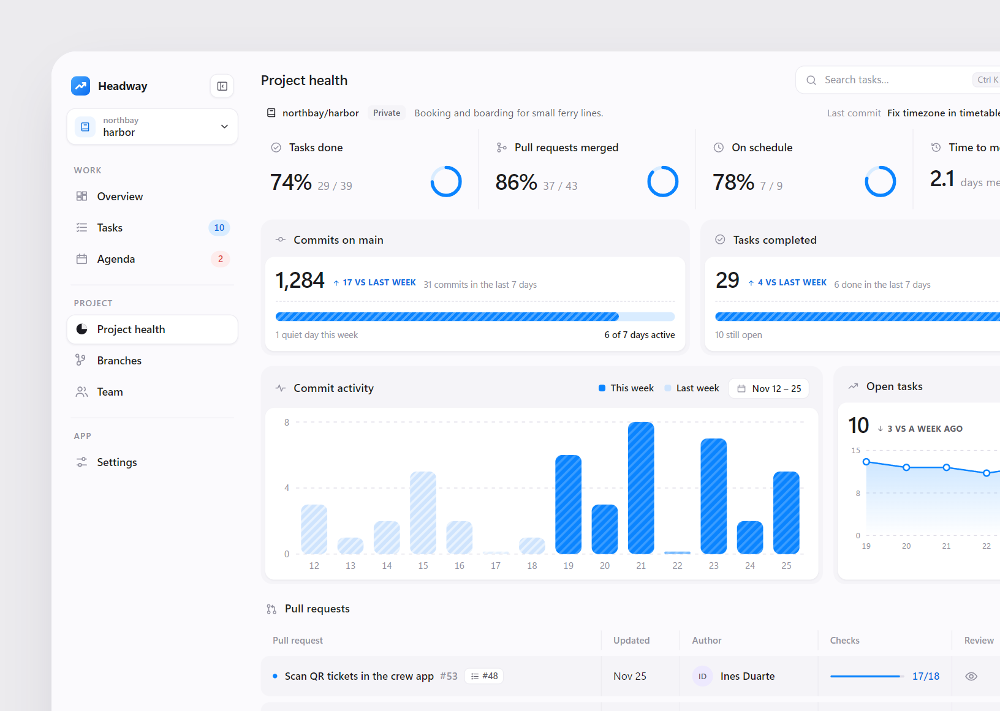

# Headway

A small desktop app for a small team working in one GitHub repository: tasks,
the pull requests linked to them, the branches, and the project's health.
No chat, no channels.



- **Tasks** are the repository's GitHub issues. Status, priority, due date,
  assignees, description and comments are editable from the app.
- **Pull requests** link to tasks the way GitHub documents it: a pull request
  whose description says `Closes #12` is attached to task 12 and closes it when
  merged into the default branch.
- **Branches** is a branch explorer over your local clone (lanes, merges,
  right-click a branch to switch to it, a properties panel).
- **Project health** shows the repository at a glance: about text, last commit,
  commits on the default branch, task and pull-request totals, recent activity.
- **Agenda** lists what is due day by day, together with the meetings from
  your Google Calendar (read-only).
- **Claude** can read and update tasks through the bundled MCP server.

## There is no server

GitHub is the backend. Signing in is your GitHub account; the team is whoever
has access to the repository; roles are the repository's access levels. Nothing
needs hosting.

The app asks GitHub for changes on a timer (30 seconds by default). Each check
is two conditional requests that GitHub answers with "not modified" when
nothing happened, which does not count against the rate limit. After a change,
only what changed is fetched. Measured against GitHub while building this: a
change made elsewhere becomes visible to the check about 10 seconds after it
happens, so a teammate's edit shows up within roughly 10 to 40 seconds.

## Download

Get `Headway-<version>-windows-x64.zip` from this repository's Releases page,
unzip it anywhere, and run `headway.exe`. Keep `headway-mcp.exe` in the same
folder. The Branches screen needs `git` on PATH. There is no installer and the
executables are not code-signed.

## Build from source

```powershell
cargo build --release -p headway -p headway-mcp
```

```powershell
.\target\release\headway.exe
```

Requirements on Windows: Rust (stable, MSVC), the Visual Studio C++ build tools,
and the WebView2 runtime. The UI files in `ui/` are compiled into the
executable. `scripts\release.ps1` builds the executables for publishing and
packs them into `dist\`.

## Sign in

Three ways, all handled in `crates/core/src/auth.rs`:

1. **GitHub CLI session**: if `gh` is installed and signed in, pick the account.
   Nothing is stored by Headway.
2. **Sign in with a code** (GitHub's device flow): for teammates without `gh`.
   One person registers an OAuth App once (GitHub, Settings, Developer settings,
   OAuth Apps), enables "Device flow", and pastes its Client ID into Headway's
   Settings. The Client ID is not a secret; no client secret is used.
3. **Personal access token** with the `repo` scope.

Tokens from 2 and 3 are kept in Windows Credential Manager, never in a file,
and never reach the UI layer.

## Projects

Add any repository you can reach on GitHub, new or existing. Adding it changes
nothing in the repository. Optionally point the project at the folder of your
local clone; only the Branches screen needs it.

## How a task maps to an issue

| Task field | On GitHub |
| --- | --- |
| To do | open issue without a status label |
| In progress / In review | open issue with the label `status: in progress` / `status: in review` |
| Done | closed as completed |
| Canceled | closed as not planned |
| Priority | label `priority: urgent`, `high`, `medium` or `low` |
| Due date | a hidden comment at the end of the issue text: `<!-- headway: {"due":"2026-12-01"} -->` |
| Assignees, title, description, comments | the issue's own |

The labels are created (with colours) the first time they are needed. Common
spellings other teams already use (`in progress`, `P1`, `priority: 1 high` ...)
are recognised when reading.

## Google Calendar on the Agenda

Connect a calendar from the Agenda screen or from Settings. It asks for the
calendar's private link, which Google Calendar calls the "Secret address in
iCal format" (Google Calendar in a browser: Settings, click the calendar on the
left, Integrate calendar). Nothing from Apple is involved; "iCal" is only the
name of the file format.

- It is read-only. Headway shows the events; it cannot create or change them.
- The link works like a password. It is stored in Windows Credential Manager on
  your computer, never in the settings file, and it is not shown again.
- Each teammate connects their own calendar. Calendars are per person, not per
  project.
- The Agenda shows the next two weeks. A calendar is downloaded again at most
  every 5 minutes, or when you press the refresh button.
- Repeating meetings, moved or deleted occurrences, all-day events and time
  zones (including daylight saving changes) are handled.
- Calendars are not exposed to Claude through the MCP server.

## Claude (MCP)

`headway-mcp.exe` is a Model Context Protocol server over stdio. It uses the
same sign-in and project list as the app. Tools: `list_projects`, `list_tasks`,
`get_task`, `create_task`, `update_task`, `add_comment`, `list_members`,
`list_pull_requests`, `link_pull_request`, `start_branch`, `project_status`.

Claude Code, once, in a terminal:

```powershell
claude mcp add --scope user headway -- "C:\Path\To\headway-mcp.exe"
```

Claude Desktop: add to `%APPDATA%\Claude\claude_desktop_config.json`

```json
{
  "mcpServers": {
    "headway": { "command": "C:\\Path\\To\\headway-mcp.exe", "args": [] }
  }
}
```

When no project is named, the server uses the project whose local folder
contains the directory Claude is working in, otherwise the one selected in the app.

## Layout

```
crates/core        the logic: GitHub client, task mapping, sync, local git, branch graph
crates/mcp         headway-mcp: the MCP server
crates/dev-server  development only: serves ui/ in a normal browser with the real core
src-tauri          the desktop app shell (Tauri 2)
ui                 the screens: plain HTML, CSS and JavaScript modules, no build step
```

## Develop

```powershell
cargo test --workspace
```

```powershell
cargo run -p headway-dev
```

The dev server listens on http://127.0.0.1:4317. Add `?mock` to the address for
invented demo data (no GitHub involved), and `?mock&showcase` for the framed
screenshot view.

## Not in this version

- Creating or editing calendar events (the calendar link is read-only).
- File attachments on tasks.
- An installer. The build produces plain executables.
- Tested on Windows only.
